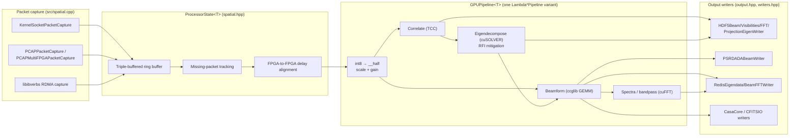
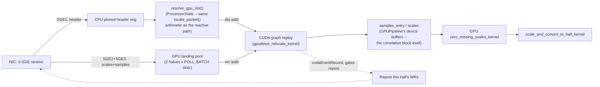
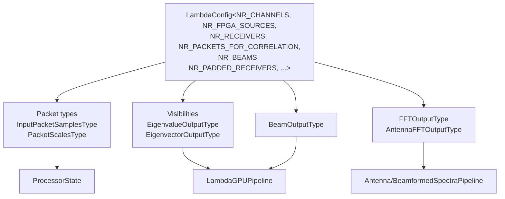
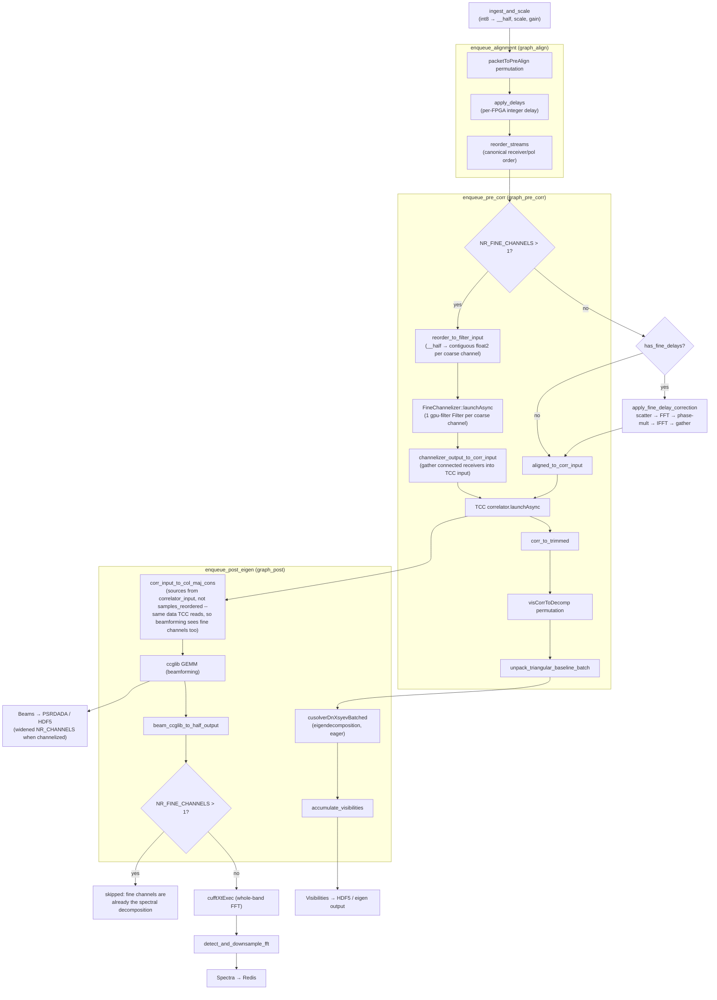
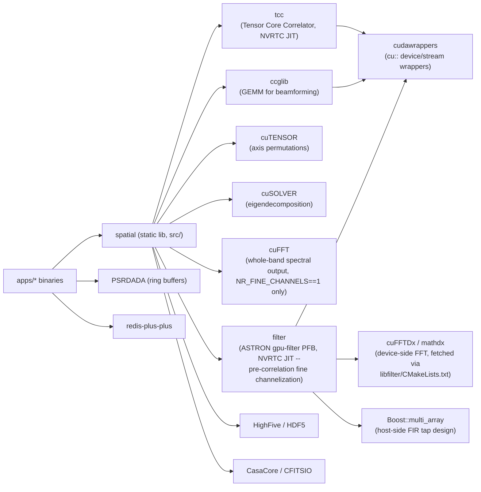
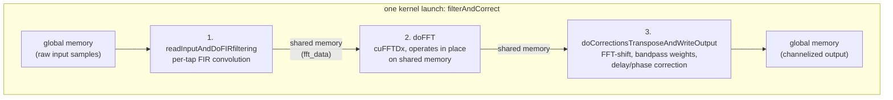
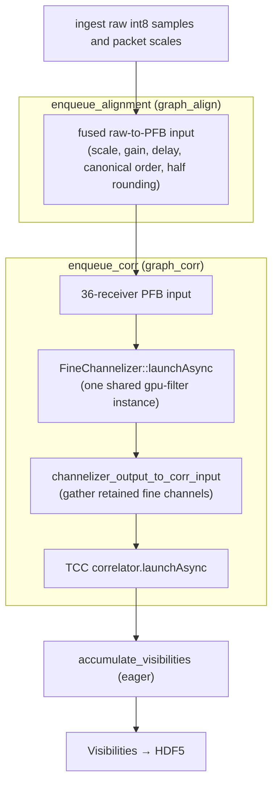

# LAMBDA pipeline architecture

Living document — update the relevant diagram in the same change that alters a pipeline's stages,
buffer shapes, or component relationships. See `CLAUDE.md`'s Documentation section for the policy.

## 1. Top-level data flow



`release_buffer` (on `ProcessorStateBase`) is the hand-back from a `GPUPipeline` once it's done
reading a buffer, so `ProcessorState` can reuse that ring-buffer slot for new packets.

### CPU worker handoff experiment

`ProcessorState::use_worker_mailboxes` selects an experimental handoff; the default
remains the shared-counter implementation. Both paths split each producer range across
the coordinator and helper workers, then wait for all active helpers before checking
buffer completion. Mailboxes use separate cache lines for coordinator-written request
generations and worker-written completion generations. Workers publish completion only
after finishing their copies; an explicit exit flag handles dispatch racing shutdown.
Task ranges, packet ownership and buffer-release ordering are unchanged.

`bench_processor --four-fpga` compares 32 channels / four FPGAs with four producers and
three helpers; `--mailboxes` selects the alternative. `--profile-dispatch` measures the
coordinator's residual barrier wait separately from its own useful work. These are
synthetic processor measurements; neither mode exercises network capture.

### 1a. GPUDirect RDMA ingest variant (`LibibverbsGpuDirectPacketCapture`)

An alternative to the `IBV` box above: instead of copying each packet into the CPU ring and later
`cudaMemcpyAsync`-ing a whole completed buffer to the GPU, the NIC DMAs payload straight into GPU
memory, and a CUDA-graph-replayed kernel relocates it to its final correlation-buffer position once
the header reveals where it belongs (channels from one FPGA interleave on a single QP — the FPGA
can't assign a distinct UDP port per channel — so the destination can't be predicted before a packet
arrives). See `include/spatial/libibverbs.hpp` and the design writeup this implements.



Key points the diagram doesn't show directly:
- **Double-buffer safety**: a landing-pool half's WRs are only reposted after its *previous*
  relocation graph replay is confirmed done (`cudaEventQuery`), so the NIC never overwrites data the
  relocation kernel hasn't read yet.
- **Placement arithmetic is shared, not duplicated**: `resolve_gpu_slot()` (on `ProcessorStateBase`,
  implemented by `ProcessorState<T,...>`) calls the same `locate_packet()`/`packet_index_for_buffer()`
  the reactive path uses (`spatial.hpp`) — the two paths can never numerically diverge.
  `GPUPipeline::gpu_landing_samples_ptr`/`gpu_landing_scales_ptr` (`pipeline_base.hpp`) expose the
  device buffers `resolve_gpu_slot()` resolves addresses into.
- **Validated at 32 channels/4-FPGA** against a synthetic busy-kernel proxy and the real
  `LambdaGPUPipeline` (`apps/bench_gpudirect_scatter.cu`, `apps/bench_gpu.cu --relocation-check`) —
  64-channel validation is deferred pending production-scale GPU memory.
- **Hardware validation remains separate**: the reviewer container includes libibverbs
  headers and compiles the capture backend, but the offline replay does not exercise NIC DMA.
  Placement and scatter tests cannot establish end-to-end GPUDirect correctness on a live NIC.

## 2. `LambdaConfig` — the shape contract

Every type used across ingest, GPU processing, and output is derived from one compile-time struct,
`LambdaConfig<...>` (`include/spatial/packet_formats.hpp`), parameterized by channel/receiver/beam
counts etc. Apps instantiate their own concrete `Config` from `NR_OBSERVING_*` CMake cache
variables and thread it through everything as a template parameter.



## 3. `Lambda*Pipeline` variants

All variants implement the `GPUPipeline` interface (`include/spatial/pipeline_base.hpp`) and share
`LambdaPipelineIngest<T>::ingest_and_scale` (`pipeline/common.hpp`) as their first step.

All eight variants share the same pre-correlation fine-channelization wiring (`FineChannelizer<T>`,
`reorder_to_filter_input`/`channelizer_output_to_*` in `spatial.cuh` — see Section 6 and
`CLAUDE.md`'s `NR_OBSERVING_FINE_CHANNELS`/`NR_OBSERVING_FINE_CHANNEL_EDGE_TRIM` docs), gated
`if constexpr (T::NR_FINE_CHANNELS > 1)` so the `NR_FINE_CHANNELS == 1` path stays byte-for-byte
identical to the pre-channelization behaviour. For the pipelines whose only spectral-resolution
source was a whole-band FFT (`LambdaGPUPipeline`, `LambdaAntennaSpectraPipeline`,
`LambdaBeamformedSpectraPipeline`, `LambdaAdaptiveBeamformedSpectraPipeline`), that FFT is deleted
entirely once channelized — gpu-filter's fine channels provide the spectral resolution directly, so
running an FFT on top would be redundant. `LambdaCorrBeamOnlyGPUPipeline` never had that
whole-band-FFT dependency (it's benchmark-only), but its fused single-kernel packet-to-correlator/
packet-to-beamformer path had no seam for a channelizer at `NR_FINE_CHANNELS == 1`, so it's the one
variant where the two branches are genuinely different code shapes rather than the same path at a
different width.

| Pipeline | Purpose | Correlates? | Beamforms? | Eigendecomposes? | Spectral output? |
|---|---|---|---|---|---|
| `LambdaGPUPipeline` | Baseline correlate+beamform+dump visibilities | yes | yes | yes | pre-correlation fine channels (FFT deleted when channelized) |
| `LambdaAntennaSpectraPipeline` | Per-antenna spectra only | no | no | no | pre-correlation fine channels (FFT deleted when channelized) |
| `LambdaBeamformedSpectraPipeline` | Beamformed spectra, no correlation | no | yes | no | pre-correlation fine channels (FFT deleted when channelized) |
| `LambdaAdaptiveBeamformedSpectraPipeline` | RFI-mitigated beamforming via eigen-projection | yes | yes (x2: raw + projected) | yes | pre-correlation fine channels (post-beam FFT/edge-trim deleted when channelized) |
| `LambdaCorrBeamOnlyGPUPipeline` | Benchmark-only correlation+beamforming, no FFT output | yes | yes | no | pre-correlation fine channels (disabled path keeps its fused fast-path kernels unchanged) |
| `LambdaProjectionPipeline` | Accumulates projection matrices for RFI mitigation | yes | no | yes | offline only |
| `LambdaPulsarFoldPipeline` | Folds beamformed time series for pulsar timing | yes (RFI-mitigate mode only) | yes | varies | no (folding is external, via DSPSR) |
| `LambdaStarspinPipeline` | Correlation-only: ingest+align+fine-channelize+correlate, visibilities only | yes | no | no | pre-correlation fine channels (no FFT/beamform ever) |

All eight support `NR_FINE_CHANNELS > 1` as of this rollout; the edge-channel trim
(`NR_FINE_CHANNEL_EDGE_TRIM`) is applied uniformly by the shared `channelizer_output_to_corr_input`/
`channelizer_output_to_col_maj_cons`/`channelizer_output_to_antenna_power` kernels, not
per-pipeline.

## 4. `LambdaGPUPipeline` stage detail

The most complete variant — correlate, beamform, RFI-mitigate via eigendecomposition, and
accumulate visibilities. Three of its stages are captured as CUDA graphs (`graph_align`,
`graph_pre_corr`, `graph_post`) when `SPATIAL_DISABLE_CUDA_GRAPH` isn't set; cuSOLVER stays eager
because it does host-side bookkeeping per call that graph replay wouldn't redo.

`NR_FINE_CHANNELS` (a `LambdaConfig` template parameter, default 1) controls pre-correlation
channelization via ASTRON's `gpu-filter` PFB (Section 6). With `NR_FINE_CHANNELS == 1` the
pipeline behaves exactly as before channelization was added: `aligned_to_corr_input` reshapes
`samples_reordered` straight into TCC's `correlator_input`, and the (now-deleted for the
channelized path) whole-band post-beamform FFT still runs. With `NR_FINE_CHANNELS > 1`, the
channelizer step replaces `aligned_to_corr_input`, correlation/beamforming/eigendecomposition all
operate on the widened `NR_CHANNELS = NR_FPGA_CHANNELS * NR_FINE_CHANNELS`, the old
`apply_fine_delay_correction` path is retired, and the whole-band FFT is skipped (the fine
channels themselves are now the spectral decomposition).



## 5. External library dependencies



## 6. How gpu-filter works: fusing FIR + FFT into one NVRTC kernel via cuFFTDx

ASTRON's `gpu-filter` (`extern`-equivalent fetched target `filter`, source at
`_deps/gpu-filter-src` once CMake configures) is a polyphase filterbank (PFB): a per-tap FIR
filter followed by an FFT, the standard two-stage channelizer used throughout radio astronomy.
What makes it fast enough for this pipeline's real-time budget is *how* those two stages are
combined — understanding that requires looking at `libfilter/kernel/FilterAndCorrect.cu`, the
single CUDA source file that does all the actual work.

### One kernel, not three

A naive PFB implementation looks like three separate passes: a FIR-filter kernel, a call into
cuFFT (a full library round-trip: enqueue, execute, synchronize), and a correction/output kernel
— each stage reading its input from global memory and writing its output back to global memory
for the next stage to re-read. PFBs are inherently *memory-bandwidth-bound*, not
compute-bound (a small number of multiply-adds per input sample), so that repeated
global-memory round-tripping between stages would dominate the runtime.

gpu-filter instead does everything in **one kernel launch**, `filterAndCorrect`
(`FilterAndCorrect.cu:418`), split into three *device functions* called back-to-back within that
one kernel body:



1. `readInputAndDoFIRfiltering` — reads raw input samples once from global memory, applies the
   per-tap FIR convolution, and writes the result into **shared memory** (`fft_data`), never
   touching global memory again for this stage.
2. `doFFT` — runs the FFT directly on that shared-memory buffer.
3. `doCorrectionsTransposeAndWriteOutput` — applies FFT-shift, bandpass weights, delay/phase
   correction, and writes the final result to global memory — the *only* other global-memory
   write in the whole kernel.

Global memory is touched exactly twice: once to read the raw samples, once to write the final
channelized output. Everything in between — the FIR-filtered samples and the FFT's
intermediate/output values — lives in shared memory and registers for the lifetime of one kernel
launch.

### Why cuFFTDx makes step 2 possible

Step 2 is only able to "just operate on the shared-memory buffer already in place" because the
FFT itself isn't a call into the cuFFT *library* (a separate compiled binary, invoked via a
runtime API, that expects its own device-memory input/output pointers and manages its own
kernel launches) — it's **cuFFTDx**, NVIDIA's header-only, template-based *device-side* FFT
library. cuFFTDx generates an FFT implementation as inlinable C++ device code, at compile time,
specialized for a fixed size/precision/direction/architecture:

```cpp
using FFT = decltype(Block() + Size<FFT_SIZE>() + Type<fft_type::c2c>() +
                      Direction<fft_direction::forward>() + Precision<float>() +
                      FFTsPerBlock<NR_TIMES_PER_ITERATION>() + SM<__CUDA_ARCH__>());
...
FFT().execute(thread_data, shared_memory);   // called from inside filterAndCorrect
```

Because `FFT` is a genuine C++ type (not a runtime handle), `FFT().execute(...)` is just another
function call *within* `filterAndCorrect` — the compiler inlines/specializes the whole FFT
computation into the same kernel body as the FIR and correction stages, operating on data that's
already sitting in shared memory rather than requiring a separate kernel launch with its own
memory transfers. This is the mechanism that makes the "one kernel touches global memory twice"
design possible at all: a library-call FFT (cuFFT) fundamentally can't be inlined this way, since
it's a separate compiled unit invoked through a runtime API boundary.

cuFFTDx also picks the optimal thread-block shape for the specialized FFT at compile time and
exposes it as a `__device__` global (`block_dim`, `FilterAndCorrect.cu:471`) — `Filter`'s
constructor reads this back via `cu::memcpyDtoH(&blockDim, filterModule.getGlobal("block_dim"),
...)` (`Filter.cc:136-140`) rather than the caller needing to hand-tune launch parameters.

### Why NVRTC (runtime compilation), not a precompiled library

`FFT_SIZE` (from `FilterArgs::nrChannels`), `NR_RECEIVERS`, `NR_TIMES_PER_ITERATION`, and the
sample formats are all only known when the pipeline constructs its `LambdaConfig` at
**build time of this repo**, but gpu-filter itself is a prebuilt/fetched dependency — it can't
know those values when *it's* compiled. Like `tcc` (the correlator), gpu-filter resolves this by
compiling `FilterAndCorrect.cu` at **runtime**, once, in `Filter`'s constructor
(`Filter.cc:25-127`, `compileModule`): the source is embedded in `libfilter.a` as a linked binary
blob, and `Filter`'s constructor calls it via NVRTC with every dimension baked in as a `-D`
preprocessor define (`-DNR_CHANNELS=32 -DNR_RECEIVERS=10 ...`), producing a `cu::Module` (PTX)
specialized for the pipeline's shapes. `FineChannelizer<T>` constructs one shared
`Filter` instance up front and reuses it across coarse channels.

### The sm_70+ requirement

`gpu-filter`'s own `CMakeLists.txt` hard-fails configure if `CMAKE_CUDA_ARCHITECTURES < 70`
(`libfilter/CMakeLists.txt`, `setup_mathdx`) — cuFFTDx requires Volta (sm_70) or newer for the
warp-level primitives and shared-memory features its generated FFT code relies on. In this
container that check is actually broken against the repo's own `CMAKE_CUDA_ARCHITECTURES=native`
default (a string, not a resolved number, at the point gpu-filter's check runs — see the build
section of this repo's `CLAUDE.md`); pass an explicit numeric value (e.g.
`-DCMAKE_CUDA_ARCHITECTURES=89` for an RTX 4060) at configure time to work around it.

### gpu-filter launch compatibility

`FineChannelizer::launchAsync` uses the `cu::Stream` overload with non-owning
stream and memory wrappers. The raw-pointer overload previously hung inside
`cuLaunchKernel` in a standalone reproducer. The underlying cause was not
established; retain the working overload unless a regression test demonstrates
that the alternative is safe.

## 7. `LambdaStarspinPipeline` stage detail

The leanest variant correlates and dumps visibilities. For fine-channelized
Starspin, one kernel reads raw packets, applies scales and gains, selects the
delayed canonical samples, and writes the PFB input. The non-channelized path
retains the original half conversion and alignment stages.

Two stages are captured as CUDA graphs (`graph_align`, `graph_corr`) when
`SPATIAL_DISABLE_CUDA_GRAPH` isn't set. Unlike `LambdaGPUPipeline` there's no
eigendecomposition/beamforming section to keep separate and eager, so `accumulate_visibilities`
runs eagerly right after `graph_corr` (a single cheap kernel call) rather than needing a third
graph.



Starspin retains all 40 FPGA receiver slots in packet ingest. In the
four-FPGA/40-coarse-channel production target, the canonical stream map puts
four disconnected slots last. The fused preparation writes only the first 36
connected receivers, so the PFB and TCC both process 36 receivers. TCC emits
666 packed baselines and handles a partial final 32-receiver tile directly.
